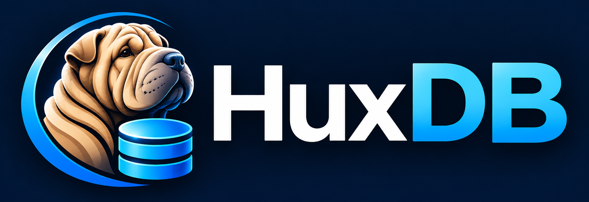

<p align="center">
  
</p>

HuxDB is a desktop database management tool for PostgreSQL. It puts browsing, designing, editing, querying and diagramming a database in one native app, for macOS, Windows and Linux.

It is built with [Tauri 2](https://tauri.app/), with a Rust backend and a React and TypeScript frontend. All database access happens in the Rust backend. PostgreSQL is the only supported engine today, and others are planned for later versions.

## Features

### Connections and the object tree

- Saved connection profiles that you can create, edit, delete and test.
- A lazily loaded tree: Connection → Databases → Schemas → Tables, Views, Materialized Views and Functions, plus each connection's saved Queries and Diagrams.
- Object lists for tables (rows, OID, owner, comment) and views.
- A Connections panel you can resize or collapse.

### Table and view designers

- **Table designer:** fields, indexes, foreign keys, uniques, checks, excludes, triggers, rules, options and comments. Save creates or alters the table in one transaction, and SQL Preview shows exactly what will run.
- **View designer:** an editable definition, advanced options and comments, with Preview, Explain and Beautify SQL. Preview and Explain run read-only and are always rolled back.

### Data editor

- Edit rows in a grid. Edits, added rows and deleted rows stay pending and colour-coded until you commit them.
- Hold an explicit transaction across commits, then commit or roll it back.
- Filter with a visual builder (nested AND / OR groups), right-click a cell to filter by its value, or type WHERE and ORDER BY clauses.
- Sort by one or several columns, page through results, and stop a long-running operation.

Tables without a primary key open read-only.

### Query editor

- SQL tabs, each with its own connection, so `SET`, temp tables and transactions behave as they do in `psql`.
- Run the selection, the current statement or the whole script, with Stop and Continue on Error.
- Context-aware completion for tables, columns, aliases, CTEs, functions and keywords, with signature help inside function calls.
- A result tab for each statement, and a Messages tab with each statement's rows, time, notices and errors.
- Save queries to a connection, or open and save external `.sql` files.

### Diagrams

- Build a read-only diagram from tables, views, materialized views, functions and procedures, across a database's schemas.
- Foreign keys are drawn as crow's foot lines between columns, with the marks derived from the catalog. Dependency lines show what each view and function reads.
- Auto Layout, an object list with search, a Properties pane and an overview mini-map.
- Labels, notes and colours, saved with the diagram. None of them touch the database.
- Saved diagrams reread the database when opened and report what has changed since the last save.
- Export to SVG, PNG or PDF, or print.

## Tech stack

| Layer | Technology |
| --- | --- |
| Desktop shell | Tauri 2 |
| Backend | Rust, sqlx, tokio |
| Frontend | React 19, TypeScript, Vite |
| State | Zustand |
| UI | Tailwind CSS 4, daisyUI 5, lucide-react |
| SQL editor | CodeMirror 6 |
| Grids | TanStack Table 9 |
| Diagrams | React Flow, ELK |

## Getting started

You need [Node.js](https://nodejs.org/), the [Rust toolchain](https://www.rust-lang.org/tools/install) and the [Tauri system prerequisites](https://tauri.app/start/prerequisites/) for your platform.

```bash
npm install             # install frontend dependencies
npm run tauri dev       # run the desktop app
npm run tauri build     # build a production bundle
```

`tauri dev` serves the frontend on port 1420 and fails if that port is taken.

## Testing

```bash
npm test                # frontend unit tests (Vitest)
npm run build           # type-check and build the frontend

cd src-tauri
cargo test              # Rust unit tests
cargo clippy
```

The tests that need a live PostgreSQL server are ignored by default. To run them, start a throwaway server:

```bash
docker run -d --rm --name huxdb-test-pg -e POSTGRES_PASSWORD=secret -p 55432:5432 postgres:17
HUXDB_TEST_PG_PORT=55432 cargo test -- --include-ignored
```

## Good to know

- HuxDB needs PostgreSQL 12 or later for the table designer.
- Connection passwords are stored in plain text in `connections.json` in the app's config directory. The file has `0600` permissions on Unix.
- Release builds are unsigned, so your OS may warn you the first time you open the app.
- Some toolbar actions are still placeholders: Delete, Import and Export in the tables list, and Open, Delete and Export in the views list. Materialized views have no designer yet.
